# Networkwalks-B084-week4-Penetration-Testing
#### Black-box Penetration Testing of Mediroza General Hospital Web Application

**W4-PM-FINAL  |  CYBERSECURITY  |  NETWORKWALKS**

| Assessment | Details |
|---|---|
| **Pentester Name (Cybersecurity Professional)** | **Ebenezer Twumasi Frimpong** |
| **Program/Batch** | B084-Networkwalks Week 4 |
| **Date** | 24 November 2026 |
| **Assessment Type** | Black-Box Penetration Testing |
| **Client/Target** | Mediroza General Hospital |
| **Permission secured from client?** | Yes |
| **Testing Environment** | Authorized Training Lab |
| **Risk Level** | Critical | 
| **Status** | Completed |

---

# 1. Liability Disclaimer

I have performed these activities only on the systems & devices where I had secured written permission or the devices/systems that I own myself. All these materials are for education and research purpose only. Do not use anything from here to break the law. The instructor, the authors and Networkwalks are not responsible for what you do with this knowledge. Every action you take is your own responsibility. Misuse can lead to criminal charges, heavy fines, loss of your job and a permanent record. In most countries unauthorised access is a crime even when nothing is damaged.

---

# 2. Executive Summary
An authorized black-box assessment of the Mediroza General Hospital web application was conducted as part of the Networkwalks Cybersecurity Internship Week4 Project. During the testing an SQL injection weakness in the patient login that enabled authentication bypass was identified. Also, an unauthenticated SQL database backup was uncovered, as well as weak password protection of 3 encrypted pathology reports. The assessment also confirmed username enumeration, directory listing and PDF metadata disclosure. This exposed backup contained 30 staff records and 10 shareholder records of the Hospital which make the overall risk of the hospital’s web application critical.

# Findings Overview
| Risk/Finding | Risk Level |
|---|---|
| SQL Injection                         | Critical |
| Database Backup Disclosure            | High     |
| Weak PDF Password Protection          | High     |
| Sensitive PDF Metadata Disclosure     | Medium   |
| Information Disclosure via robots.txt | Low      |

---

# 3. Scope and Methodology
Scope: The assigned Mediroza General Hospital web application and associated files encountered during the authorized assessment by Networkwalks.
Tactic: Reconnaissance - Scanning and Enumeration - Initial Access - PDF Password Security - PDF Metadata Examination.

The table below lists each tool used in this report and its purpose.

| Tool | Purpose |
|---|---|
| Kali Linux                    | Operating systems used for reconnaissance activities.              |
| WHOIS, whatweb                | Find domain registration details and web technologies.             |
| cURL                          | Read the HTTP response headers of the website.                     |
| Google Chrome                 | Manual login testing, portal verification and evidence collection. |
| Networkwalks Hash Calculator  | Extraction of PDF hashes.                                          |
| Networkwalks Password Cracker | Dictionary password recovery.                                      |
| ExifTool                      | Meta Data examination.                                             |

---

# 4. Activities Performed

## 4.1 Footprinting & Reconnaissance

I performed reconnaissance against the medirozahospital.com domain using 3 Kali Linux tools and a plain-text configuration file: WHOIS, WhatWeb, cURL and robots.txt. Each tool was used to collect a different type of information about the target. The information gathered are as follows:

1.	**WHOIS**: Used to obtain publicly available domain registration information and identify the domain’s name servers. NameCheap was identified as the register.

2.	**WhatWeb**: Used to identify technologies used by the website. It identified HTTPServer as LiteSpeed.
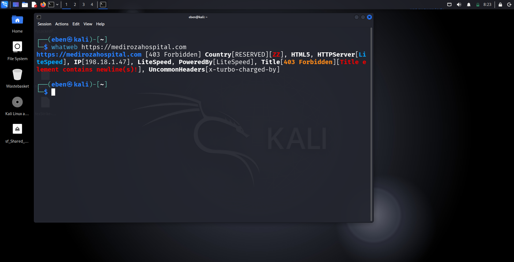

3.	**cURL**: : cURL was used with the -I option to inspect the HTTP response headers. It identified the server as LiteSpeed & x-turbo-charged-by: LiteSpeed which is a high-performance alternate for Apache.
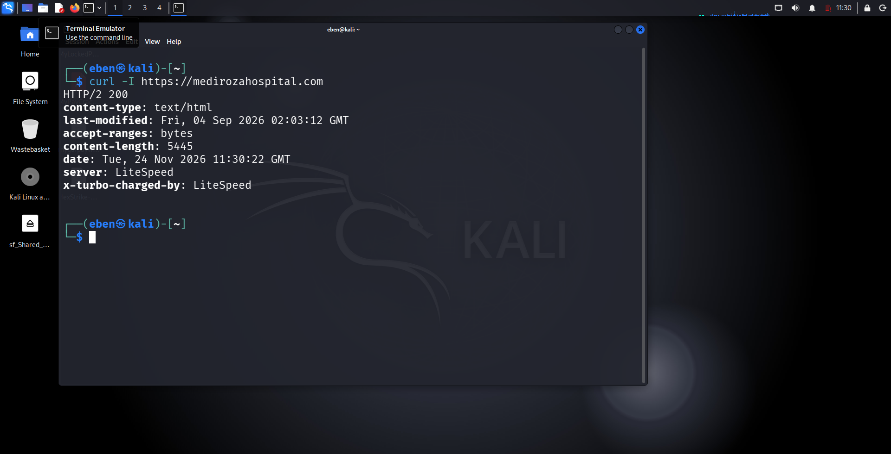

4.	**Robots.txt**: The application's robots.txt file was found to publicly list restricted directories such as /patient/, /staff/ and /old/, which inadvertently exposes the application's internal structure and identifies high-value targets for further enumeration.
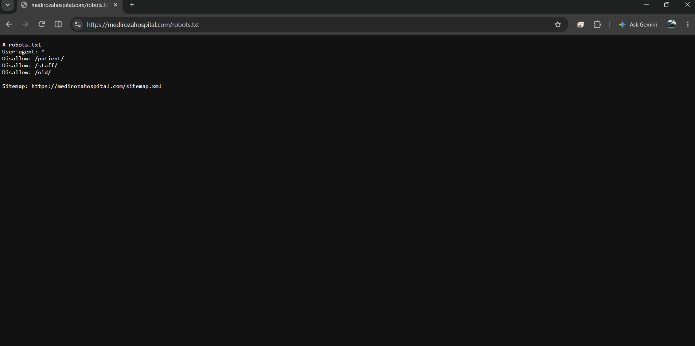

## 4.2 Scanning and Enumeration

Scanning and enumeration was performed to discover directories or access to exposed contents. This revealed exposed directory/backup resource “mediroza_db_backup_2019.sql”, which was accessed without any form of authentication. Further inspection revealed the backup contained a staff table of 30 records and a shareholders table of 10 records. This exposed field contained data including names, contact details, national identifiers, salaries and ownership information. Publicly accessible backup files exposed the organization’s financial and other sensitive information.
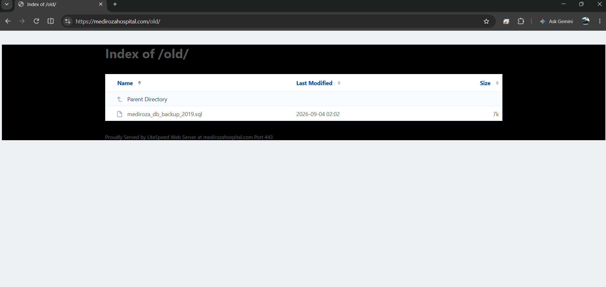
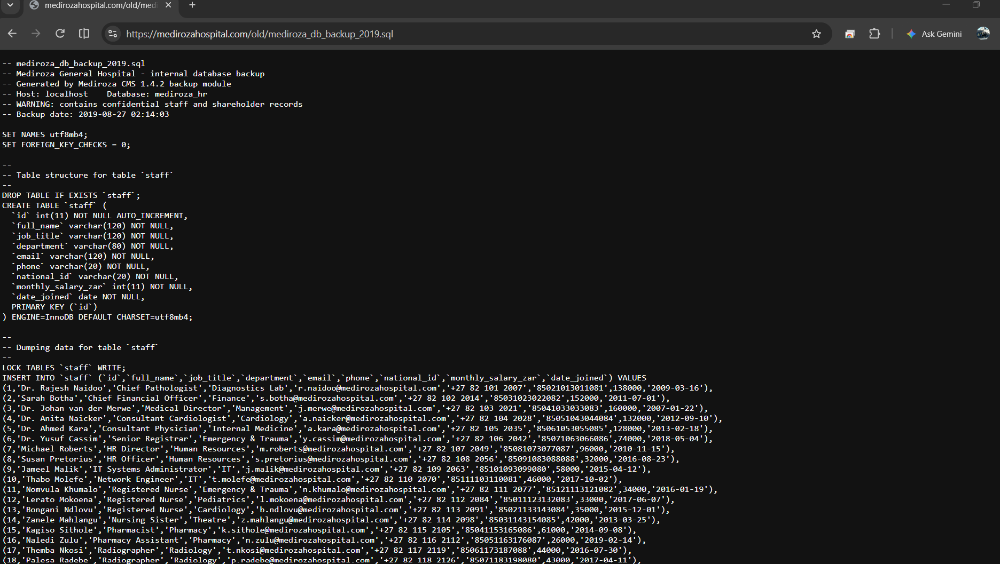
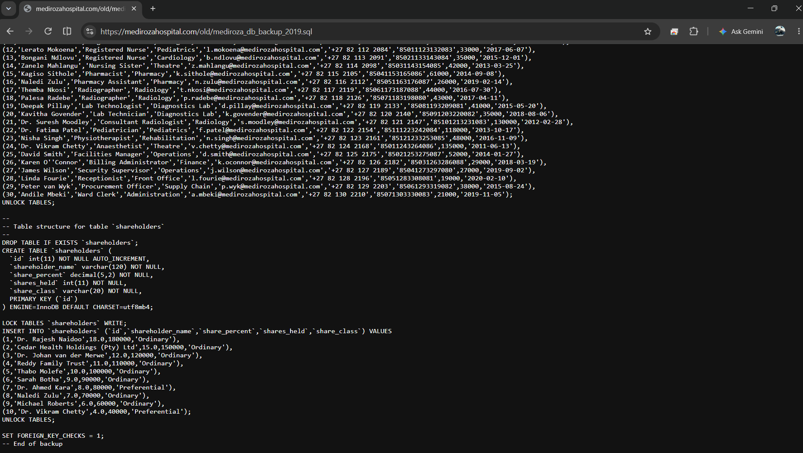

## 4.3 Initial Access

An SQL Injection was performed to identify authentication responses, unsafe SQL input handling and access to patient portal. Malformed input in the username parameter produced MySQL syntax warning indicating unsafe handling of SQL input in the authentication process. An injection of “admin’--” was entered in the username field which provided access to My lab reports portal with 3 downloaded be encrypted pathology reports. This authentication weakness permitted access to protected portal functionality and retrieval of the encrypted pathology reports.
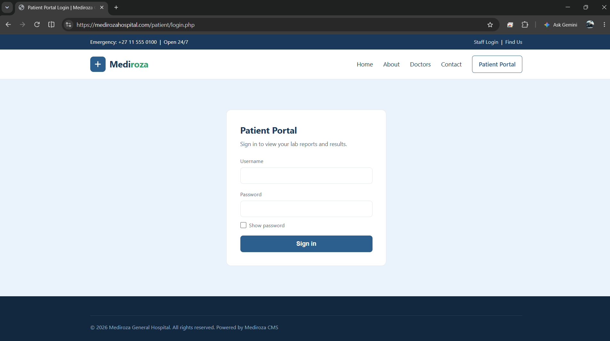
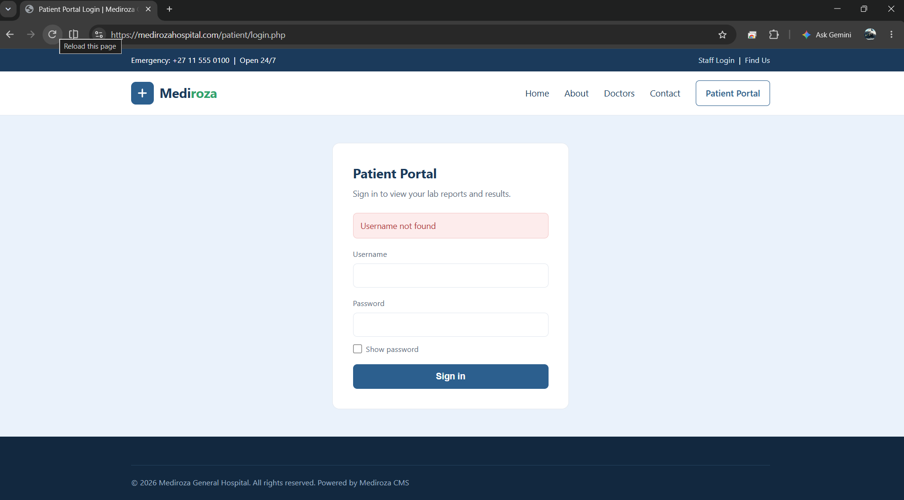
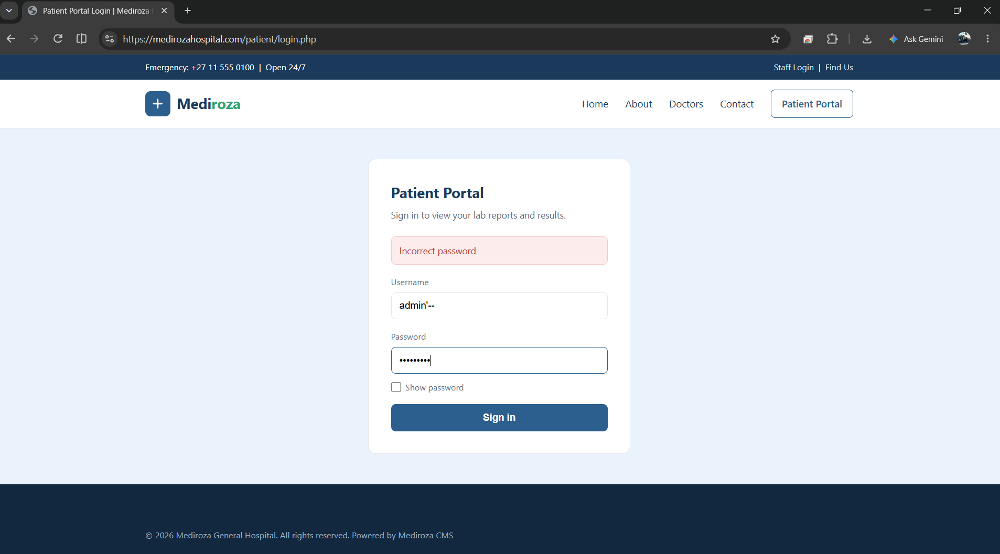
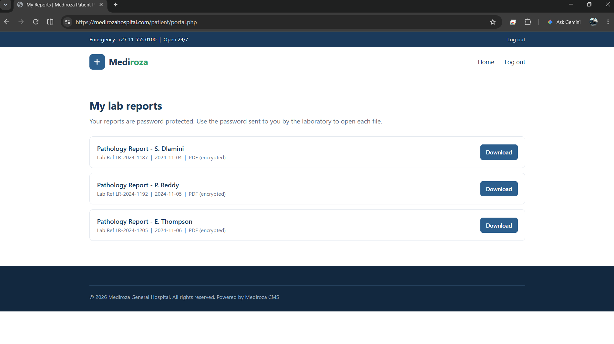

## 4.4 PDF Password Security

The protected PDF files were found to rely on weak or predictable passwords. The hashes were extracted with Networkwalks Hash Calculator and tested using Networkwalks Password Cracker. Although password protection was enabled on these files, the weak credentials significantly reduced the effectiveness of the protection mechanism.
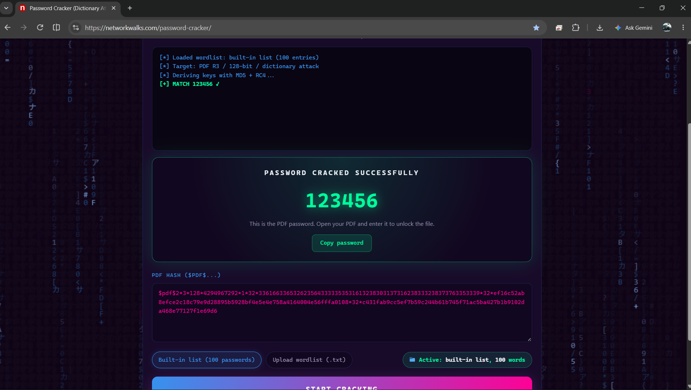
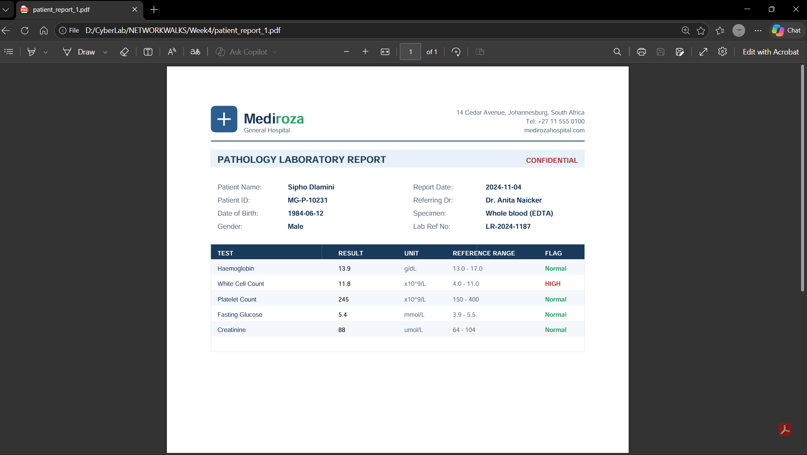
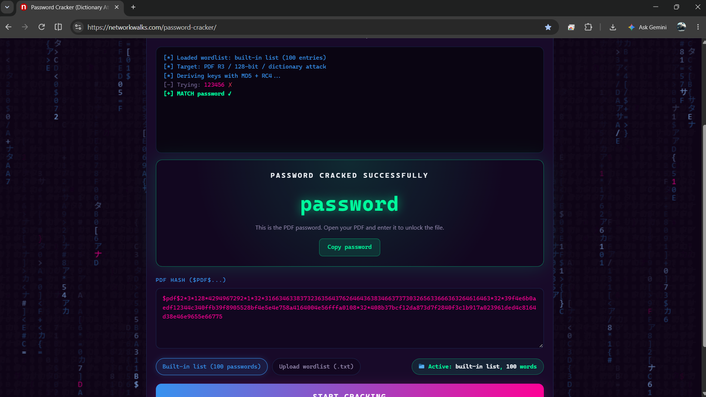
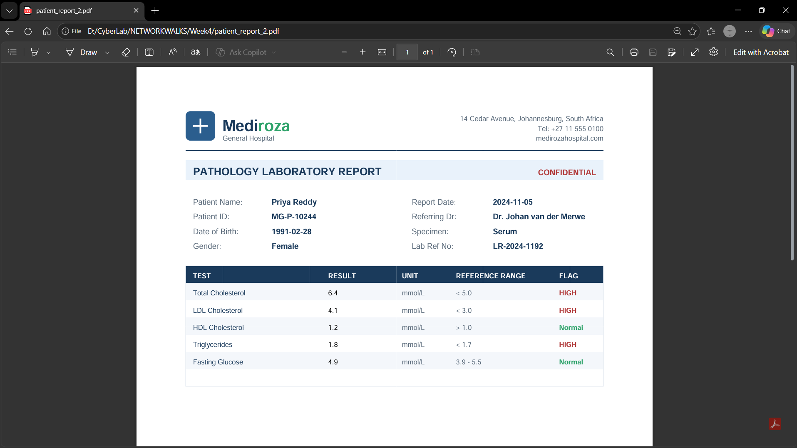
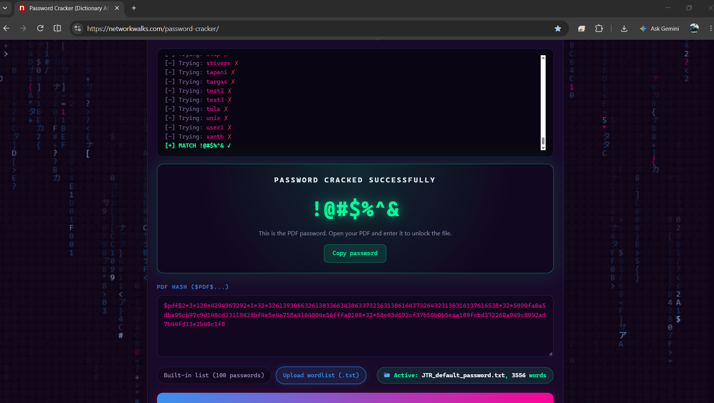
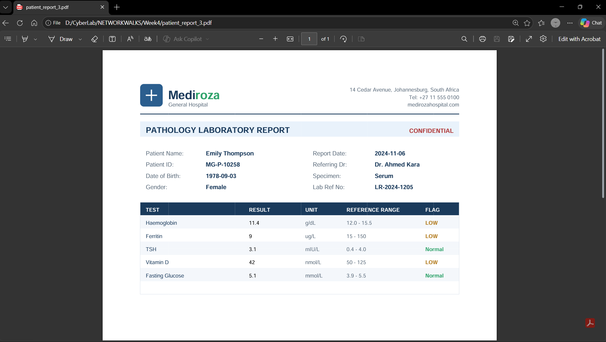

## 4.5 PDF Metadata Examination

The metadata of all 3 decrypted PDF files were correlated with database records to identifier staff members. The ‘j.malik’ identifier matched Jameel Malik, an IT Systems Administrator in the exposed staff table. The PDF output corroborated the backup location uncovered during the reconnaissance and enumeration phase. Thus, the files’ metadata disclosed software details, internal identifier and a backup-directory reference thereby strengthening the connections between the various findings.
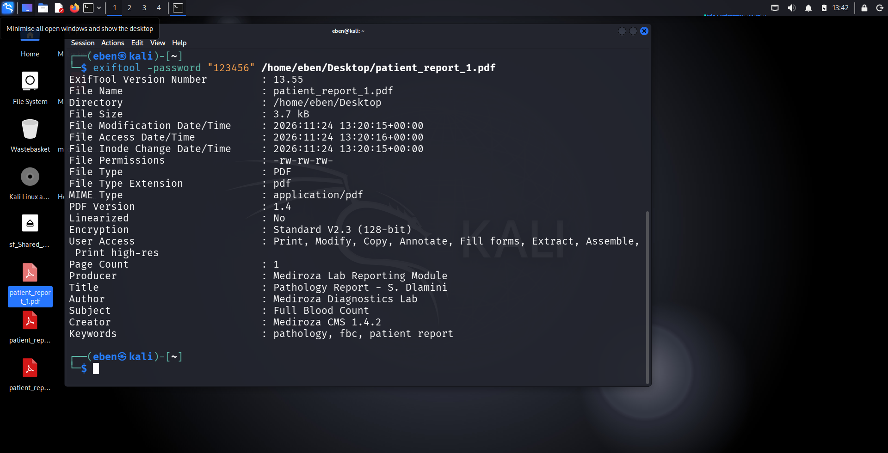
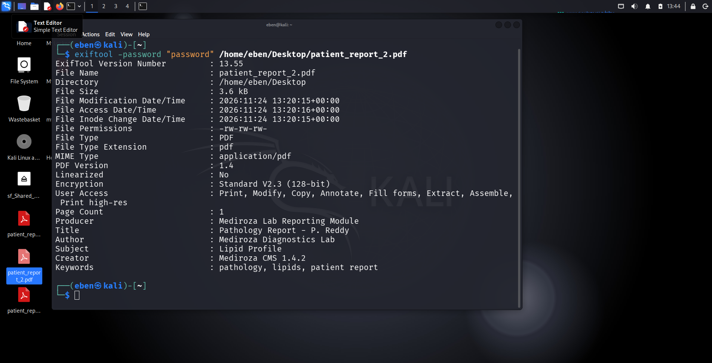
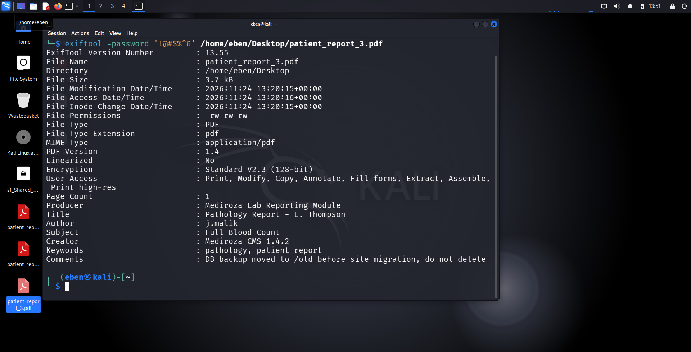

---

# 5. Findings and Risk Analysis
| **\#** | **Risk/Findings**                           | **Potential Impact**                                  | **Remediation**                                                                                            | **Risk Level** |
|--------|----------------------------------------------|-------------------------------------------------------------|-----------------------------------------------------------------------------------------------------------------|----------------|
| 1      | SQL Injection           | Allows attackers to read, modify, or delete sensitive database data, bypass authentication and potentially take over the underlying server        | Use parameterized queries for all database calls, enforce strict input validation and apply the principle of least privilege to database accounts | **● Critical**   |
| 2      | Database Backup Disclosure               | Enables attackers to download exposed backup files, gaining deep application intelligence or direct access to sensitive records              | Move all database backups outside the public web root directory, block access to backup extensions at the web server level and encrypt stored backups                                              | **● High**      |
| 3      | Weak PDF Password Protection           | Leaves sensitive document contents vulnerable to rapid offline brute-force cracking, unauthorized extraction and undetected tampering | Enforce strong, complex passwords using modern AES-256 encryption standards and apply digital signatures to detect file tampering                                                    | **● High**      |
| 4      | Sensitive PDF Metadata Disclosure                  | Exposes hidden internal properties (author names, software versions, internal file paths) that aid attackers in targeted reconnaissance                 | Strip metadata from all PDFs using sanitization tools (such as exiftool) before publishing externally                                           | **● Medium**      |
| 5      | Information Disclosure via robots.txt       | Assists attackers in mapping out hidden directories, admin panels or sensitive application routes   | Remove sensitive paths from robots.txt and rely on proper authentication and access controls rather than obscurity to protect private endpoints                                                 | **● Low**   |

---

# 6. Recommendations

Based on the observations from these activities, the following security improvements are made in order of priorities:

1.	**Immediate Triage**: Focus engineering resources entirely on SQL Injection and Database Backup Disclosure. Exposed backups can often be deleted or moved within minutes, immediately eliminating a major data-leak vector.

2.	**Automate Document Hygiene**: Integrate automated metadata scrubbing and encryption checks into your document publishing workflow, so employees do not have to remember to sanitize PDFs manually.

3.	**Defence-in-Depth**: Do not use robots.txt as a security control. Assume any URL hosted on a public server will eventually be discovered and protect all non-public routes with server-side authorization checks.

---

# 7. Conclusion

The assessment demonstrated how combined weaknesses in authentication, file access controls, and document handling expose sensitive patient data to unauthorized access. Addressing the most critical findings, specifically the patient-portal authentication bypass and the publicly accessible SQL backup, requires immediate action to prevent a severe data breach. Implementing parameterized queries, enforcing strict access controls on backups and reports, upgrading PDF encryption as well as sanitizing document metadata will significantly reduce the Mediroza Hospital web application's attack surface and protect patient confidentiality.

---

# 👤 Author

**Ebenezer Twumasi Frimpong**\
Cybersecurity Intern B084

LinkedIn: [https://linkedin.com/in.ebenezer-twumasi-frimpong-0689143b8/](https://www.linkedin.com/in/ebenezer-twumasi-frimpong-0689143b8/)
